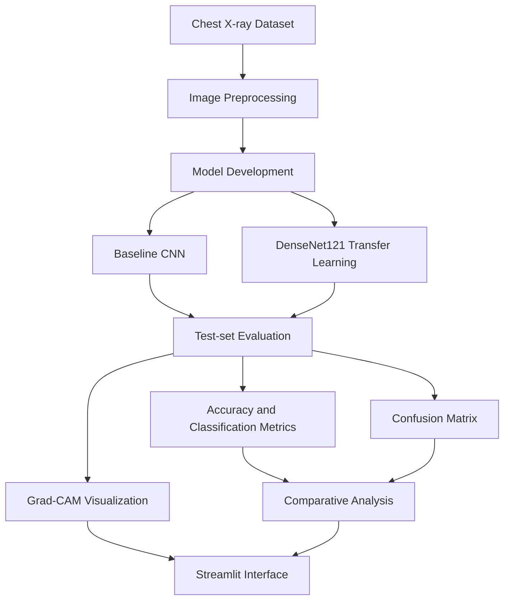

# 🩻 Pneumonia Detection from Chest X-rays Using Deep Learning and Explainable AI

<p align="center">
  
  
  
  
  
</p>

<p align="center">
  <strong>Deep Learning-Based Chest X-ray Classification with Visual Model Explanations</strong>
</p>

## 📌 Overview

This project presents a deep learning framework for classifying chest X-ray images into two categories: **NORMAL** and **PNEUMONIA**. It combines convolutional neural networks, transfer learning, and Explainable Artificial Intelligence (XAI) to evaluate model performance and visualize image regions influencing predictions.

A custom Convolutional Neural Network (CNN) serves as the baseline model, while DenseNet121 is implemented to investigate the benefits of transfer learning. Grad-CAM generates heatmaps for qualitative inspection of model predictions, and a Streamlit interface provides an interactive demonstration of the classification pipeline.

The objective is to explore the effectiveness of deep learning for chest X-ray image classification while examining model interpretability and evaluation limitations.

## 🎯 Key Results

| Metric | Baseline CNN | DenseNet121 |
|:--|--:|--:|
| Test accuracy | 72.92% | **87.50%** |
| Weighted F1-score | 68.02% | **87.17%** |
| NORMAL recall | 29.06% | **73.50%** |
| PNEUMONIA recall | 99.23% | 95.90% |
| Test loss | 1.5270 | **0.3103** |

DenseNet121 achieved an improvement of **14.58 percentage points in test accuracy** compared with the baseline CNN. It also showed substantially better recall for the NORMAL class, resulting in more balanced classification performance on the evaluated test set.

These results are specific to the current experiment and do not establish clinical diagnostic performance.

## 🧬 Dataset

The project uses the publicly available **Chest X-Ray Images (Pneumonia)** dataset.

- **Source:** [Kaggle — Chest X-Ray Images (Pneumonia)](https://www.kaggle.com/datasets/paultimothymooney/chest-xray-pneumonia)
- **Original research:** Kermany et al. (2018)
- **Classification task:** Binary image classification
- **Classes:** NORMAL and PNEUMONIA
- **Input dimensions:** 224 × 224 × 3
- **Test set:** 624 images

| Class | Test images |
|:--|--:|
| NORMAL | 234 |
| PNEUMONIA | 390 |
| **Total** | **624** |

The dataset contains unequal numbers of NORMAL and PNEUMONIA images in the test set. Therefore, accuracy is interpreted alongside class-specific precision, recall, F1-score, and the confusion matrix.

## ⚙️ Methodology

The project follows a structured image classification workflow:



### 1. Image preprocessing

- Organize chest X-ray images into NORMAL and PNEUMONIA classes.
- Resize images to 224 × 224 pixels.
- Prepare image tensors in the format expected by the selected model.
- Use training and validation data during model development.
- Evaluate the trained models on the held-out test set.

### 2. Baseline CNN

A custom CNN is implemented as the reference architecture. It uses convolutional layers with 32, 64, and 128 filters, ReLU activations, max-pooling, a fully connected layer, dropout regularization, and a sigmoid output layer.

The baseline establishes a performance reference for comparison with the transfer-learning approach.

### 3. DenseNet121 transfer learning

DenseNet121 is used as the main transfer-learning architecture. Its densely connected layers promote feature reuse and information flow throughout the network.

The classification model consists of:

- A pretrained DenseNet121 feature extractor
- Global average pooling
- A dense layer with 128 units
- Dropout regularization
- A sigmoid output layer for binary classification

The saved model contains approximately **7.17 million parameters**, of which approximately 131,329 are trainable. Class weighting was used during training to account for differences in class representation.

## 📈 Model Evaluation

### DenseNet121 classification report

| Metric | NORMAL | PNEUMONIA |
|:--|--:|--:|
| Precision | 91.49% | 85.78% |
| Recall | 73.50% | 95.90% |
| F1-score | 81.52% | 90.56% |
| Support | 234 | 390 |

### Confusion matrix

The confusion matrix summarizes correct and incorrect classifications for each actual class.

| Actual / Predicted | NORMAL | PNEUMONIA |
|:--|--:|--:|
| NORMAL | 172 | 62 |
| PNEUMONIA | 16 | 374 |


The model correctly classified 172 NORMAL images and 374 PNEUMONIA images. It misclassified 62 NORMAL images as PNEUMONIA and 16 PNEUMONIA images as NORMAL.

### Model comparison


The comparison indicates that DenseNet121 achieved better overall accuracy, weighted F1-score, and NORMAL-class recall. However, its PNEUMONIA recall was slightly lower than that of the baseline CNN. Both types of classification error remain relevant when assessing model behavior.

## 🔍 Explainable AI Using Grad-CAM

Gradient-weighted Class Activation Mapping (Grad-CAM) is used to visualize image regions that influence the model's predictions.

The selected DenseNet121 convolutional layer is `conv5_block16_2_conv`.

The generated heatmaps are overlaid on chest X-ray images to support qualitative inspection of correctly classified and misclassified examples.

### PNEUMONIA example


### NORMAL example


Grad-CAM provides an exploratory visualization of model sensitivity. It does not prove that the highlighted regions represent medically valid features or establish the clinical reliability of a prediction.

## 🖥️ Streamlit Application

The project includes a Streamlit-based research interface for demonstrating the trained model.

The application is designed to support:

- Uploading chest X-ray images in JPG, JPEG, or PNG format
- Generating a NORMAL or PNEUMONIA prediction
- Displaying predicted class probabilities
- Visualizing Grad-CAM heatmaps
- Downloading the generated visualization

### Run locally

**1. Install the dependencies**

```bash
pip install -r requirements.txt
```

**2. Confirm the model file is available**

```text
models/densenet121_best.keras
```

**3. Launch the application**

```bash
streamlit run app.py
```

The image preprocessing in the application must match the preprocessing used during model training. The application should be tested end-to-end before being demonstrated or deployed.

## 🗂️ Project Structure

```text
Pneumonia_DeepLearning_Project/
├── dataset/
│   ├── archive.zip
│   └── chest_xray/
├── notebooks/
│   └── 01_Project_Setup.ipynb
├── models/
│   ├── baseline_cnn_best.keras
│   └── densenet121_best.keras
├── results/
│   ├── baseline_cnn_accuracy.png
│   ├── baseline_cnn_loss.png
│   ├── densenet121_test_results.json
│   ├── densenet121_confusion_matrix.png
│   └── model_comparison.png
├── gradcam/
│   ├── pneumonia_gradcam_example.png
│   ├── correct_pneumonia_gradcam.png
│   └── correct_normal_gradcam.png
├── app.py
├── requirements.txt
└── README.md
```

## ⚠️ Limitations and Future Work

The current evaluation is based on a single publicly available dataset, and external validation has not been performed. False-positive and false-negative predictions remain, and Grad-CAM visualizations do not establish clinical validity.

Future work could include:

- Evaluation on independent datasets and external clinical populations
- Patient-level splitting and data-leakage checks
- Cross-validation and confidence interval estimation
- ROC-AUC, specificity, and probability calibration analysis
- Comparison with additional pretrained architectures
- Quantitative evaluation of explanation quality and model robustness

## 📚 References

1. Huang, G. et al. “Densely Connected Convolutional Networks.” *CVPR*, 2017, pp. 4700–4708.
2. Kermany, D. S. et al. “Identifying Medical Diagnoses and Treatable Diseases by Image-Based Deep Learning.” *Cell*, 172(5), 2018, pp. 1122–1131.e9.
3. Rajpurkar, P. et al. “CheXNet: Radiologist-Level Pneumonia Detection on Chest X-Rays with Deep Learning.” arXiv:1711.05225, 2017.
4. Selvaraju, R. R. et al. “Grad-CAM: Visual Explanations from Deep Networks via Gradient-Based Localization.” *ICCV*, 2017, pp. 618–626.
5. Chattopadhay, A. et al. “Grad-CAM++: Generalized Gradient-Based Visual Explanations for Deep Convolutional Networks.” *WACV*, 2018, pp. 839–847.
6. Mooney, P. [Chest X-Ray Images (Pneumonia) Dataset](https://www.kaggle.com/datasets/paultimothymooney/chest-xray-pneumonia). Kaggle.
7. TensorFlow. [DenseNet121 Documentation](https://www.tensorflow.org/api_docs/python/tf/keras/applications/DenseNet121).
8. Streamlit. [Official Documentation](https://docs.streamlit.io/).

---

<p align="center">
  <strong>Developed by Sofiya Sanjeev Chavarekar</strong>
  <br />
  <a href="https://github.com/SofiyaBioAI">GitHub</a> ·
  <a href="https://www.linkedin.com/in/sofiya-chavarekar/">LinkedIn</a>
  <br /><br />
  <em>Research Prototype — Not for Clinical Diagnosis</em>
</p>
