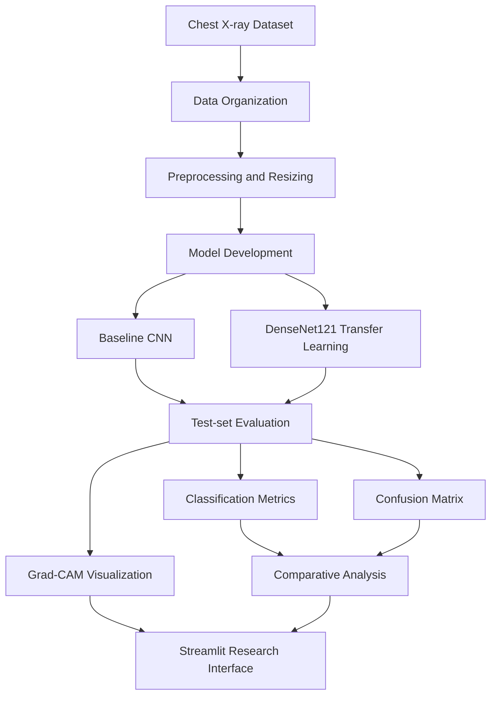

# 🩻 Deep Learning-Based Detection of Pneumonia from Chest X-rays Using Explainable AI

<p align="center">
  <strong>An Explainable Deep Learning Framework for Medical Image Classification</strong>
  <br />
  Research Project | Bioengineering | Medical Image Analysis
</p>

<p align="center">
  
  
  
  
  
</p>

<p align="center">
  
  
  
</p>

---

## 📌 Overview

Pneumonia is a respiratory infection that can produce abnormalities visible in chest X-ray images. Deep learning offers a way to identify image patterns associated with the disease, but understanding how a model arrives at its predictions is equally important in medical image analysis.

This project develops a **deep learning pipeline for classifying chest X-ray images as NORMAL or PNEUMONIA**, combining conventional convolutional neural networks with transfer learning and explainable artificial intelligence.

Two architectures are evaluated: a custom Convolutional Neural Network (CNN) and DenseNet121. Grad-CAM is used to generate visual explanations of model predictions, while a Streamlit interface demonstrates the classification workflow.

The project emphasizes model evaluation, visual interpretability, and responsible reporting of experimental findings.

> **Research objective:** Explore whether transfer learning improves chest X-ray classification performance and use Grad-CAM to inspect the image regions influencing model predictions.

## 📊 Key Results

<p align="center">
  
  
  
</p>

| Evaluation metric | Baseline CNN | DenseNet121 |
|:--|--:|--:|
| Test accuracy | 72.92% | **87.50%** |
| Weighted F1-score | 68.02% | **87.17%** |
| NORMAL recall | 29.06% | **73.50%** |
| PNEUMONIA recall | 99.23% | 95.90% |
| Test loss | 1.5270 | **0.3103** |

**Key observation:** DenseNet121 improved test accuracy by **14.58 percentage points** over the baseline CNN and substantially improved recognition of NORMAL images. However, the model still made both false-positive and false-negative predictions.

*Results represent the current evaluation on the selected test set and do not establish clinical performance.*

## 🎯 Project Objectives

- Develop a binary chest X-ray classification pipeline.
- Establish a baseline using a custom CNN.
- Apply transfer learning using DenseNet121.
- Compare the models using accuracy, precision, recall, F1-score, loss, and confusion matrices.
- Apply Grad-CAM to visualize regions influencing model predictions.
- Develop a Streamlit research interface for interactive demonstration.
- Identify experimental limitations and potential directions for further research.

## 🧬 Dataset

The project uses the publicly available **Chest X-Ray Images (Pneumonia)** dataset.

| Property | Description |
|:--|:--|
| Dataset source | [Kaggle — Chest X-Ray Images (Pneumonia)](https://www.kaggle.com/datasets/paultimothymooney/chest-xray-pneumonia) |
| Original research | Kermany et al., 2018 |
| Classification task | Binary classification |
| Classes | NORMAL, PNEUMONIA |
| Model input | 224 × 224 × 3 |
| Test set | 624 images |

### Test-set distribution

| Class | Images |
|:--|--:|
| NORMAL | 234 |
| PNEUMONIA | 390 |
| **Total** | **624** |

The unequal class distribution is important when interpreting model metrics. Accuracy should therefore be considered alongside class-specific recall, precision, F1-score, and the confusion matrix.

## ⚙️ Methodology



### 1. Image preprocessing

- Organize images into NORMAL and PNEUMONIA categories.
- Resize images to 224 × 224 pixels.
- Prepare images in the format expected by the model.
- Use training and validation data for model development.
- Reserve the test set for final evaluation.

### 2. Baseline CNN

The baseline model consists of convolutional layers, ReLU activations, max-pooling, a fully connected layer, dropout regularization, and a sigmoid output layer.

**Purpose:** Establish a reference performance level before applying transfer learning.

### 3. DenseNet121 transfer learning

DenseNet121 uses densely connected convolutional blocks to encourage feature reuse and information flow.

The classification pipeline comprises:

- Pretrained DenseNet121 backbone
- Global average pooling
- Dense layer with 128 units
- Dropout regularization
- Sigmoid output for binary classification

The saved configuration contains approximately **7.17 million parameters**, including approximately 131,329 trainable parameters.

Class weighting was used during training to account for differences in class representation.

## 📈 Model Evaluation

### DenseNet121 classification report

| Metric | NORMAL | PNEUMONIA |
|:--|--:|--:|
| Precision | 91.49% | 85.78% |
| Recall | 73.50% | 95.90% |
| F1-score | 81.52% | 90.56% |
| Support | 234 | 390 |

### Confusion matrix

Rows represent actual classes; columns represent predicted classes.

| Actual / Predicted | NORMAL | PNEUMONIA |
|:--|--:|--:|
| NORMAL | 172 | 62 |
| PNEUMONIA | 16 | 374 |

The model correctly classified 172 NORMAL images and 374 PNEUMONIA images. It incorrectly classified 62 NORMAL images as PNEUMONIA and 16 PNEUMONIA images as NORMAL.

### Evaluation visualization

Add the saved confusion matrix to the repository:


*If the image does not render, verify that the file exists at the specified path and that its filename matches the repository.*

## 🔍 Explainable AI — Grad-CAM

**Gradient-weighted Class Activation Mapping (Grad-CAM)** generates a heatmap that highlights image regions contributing to a model's output.

The project uses the DenseNet121 convolutional layer:

`conv5_block16_2_conv`

Grad-CAM heatmaps are overlaid on chest X-ray images to support qualitative inspection of:

- Correctly classified PNEUMONIA images
- Correctly classified NORMAL images
- Misclassified images

### Example visualizations

<p align="center">
  <strong>PNEUMONIA Example</strong>
  <br />
  
</p>

<p align="center">
  <strong>NORMAL Example</strong>
  <br />
  
</p>

Grad-CAM is an exploratory explanation method, not proof that the model relies on clinically valid features. Heatmaps must be interpreted alongside quantitative evaluation and, in future research, expert assessment.

## 🖥️ Streamlit Demonstration

The project includes a Streamlit-based research interface for demonstrating the image classification pipeline.

Depending on the current implementation, the interface supports:

- Uploading a chest X-ray image
- Generating a NORMAL or PNEUMONIA prediction
- Displaying class probabilities
- Viewing a Grad-CAM heatmap
- Downloading the generated visualization

**Application disclaimer:** `Research Prototype — Not for Clinical Diagnosis.`

## 🗂️ Repository Structure

```text
Pneumonia_DeepLearning_Project/
│
├── dataset/
│   ├── archive.zip
│   └── chest_xray/
│
├── notebooks/
│   └── 01_Project_Setup.ipynb
│
├── models/
│   ├── baseline_cnn_best.keras
│   └── densenet121_best.keras
│
├── results/
│   ├── baseline_cnn_accuracy.png
│   ├── baseline_cnn_loss.png
│   ├── densenet121_test_results.json
│   ├── densenet121_confusion_matrix.png
│   └── model_comparison.png
│
├── gradcam/
│   ├── pneumonia_gradcam_example.png
│   ├── correct_pneumonia_gradcam.png
│   └── correct_normal_gradcam.png
│
├── app.py
├── requirements.txt
└── README.md
```

*This is the intended layout. Update it to match the files actually committed to your repository.*

## 🚀 Installation and Usage

### Prerequisites

- Python version compatible with the selected TensorFlow release
- pip
- Git
- Trained DenseNet121 model checkpoint

### 1. Clone the repository

Replace the placeholders with your actual GitHub repository details.

```bash
git clone https://github.com/YOUR_USERNAME/YOUR_REPOSITORY.git
cd YOUR_REPOSITORY
```

### 2. Create a virtual environment

```bash
python -m venv .venv
```

Activate it on Windows:

```bash
.venv\Scripts\activate
```

Activate it on Linux or macOS:

```bash
source .venv/bin/activate
```

### 3. Install dependencies

```bash
pip install -r requirements.txt
```

Example starting dependencies for the interface:

```text
streamlit
tensorflow
numpy
matplotlib
opencv-python-headless
Pillow
```

For reproducible deployment, pin tested package versions in `requirements.txt`.

### 4. Check the model path

Ensure the application loads the trained model from the correct relative path:

```text
models/densenet121_best.keras
```

The model checkpoint must be available locally or through a documented download procedure.

### 5. Launch the application

```bash
streamlit run app.py
```

Open the local URL printed in the terminal.

**Important:** Confirm that the application's preprocessing matches the model's training preprocessing before interpreting predictions.

## 🔬 Reproducibility

For a reproducible research release, document the following:

- Dataset source and version
- Train, validation, and test split methodology
- Random seeds
- Image resizing, normalization, and augmentation settings
- Optimizer, learning rate, batch size, and stopping criteria
- Model initialization and fine-tuning strategy
- Class weights and classification threshold
- Python, TensorFlow, and other dependency versions
- Evaluation scripts and saved model checkpoints

The test set should remain separate from model tuning to reduce the risk of overly optimistic evaluation.

## ⚠️ Limitations

- Evaluation is based on one publicly available dataset.
- The test classes are imbalanced.
- External generalization has not been established.
- False-positive and false-negative predictions remain.
- Grad-CAM does not establish clinical validity.
- Prospective clinical validation has not been performed.
- Dataset-specific artifacts and biases may influence predictions.

These limitations mean the results should be considered experimental and educational rather than evidence of readiness for clinical use.

## 🔮 Future Scope

- External validation on independent datasets
- Patient-level splitting and data-leakage checks
- Cross-validation and confidence interval estimation
- ROC-AUC, specificity, calibration, and precision-recall analysis
- Comparison with additional pretrained architectures
- Quantitative evaluation of explanation quality
- Robustness and subgroup analysis
- Model-version tracking and reproducible deployment

## 📝 Conclusion

This project demonstrates a deep learning workflow for chest X-ray classification using a baseline CNN and DenseNet121 transfer learning. DenseNet121 achieved **87.50% test accuracy** and a **weighted F1-score of 87.17%** in the current evaluation, outperforming the baseline model on the selected test set.

Grad-CAM provides qualitative visualizations of image regions influencing model predictions, while the Streamlit interface demonstrates how classification and explainability can be combined in a research prototype.

Further evaluation on independent datasets and rigorous validation of both predictive performance and explanations are necessary before considering any clinical application.

## 📚 References

1. Huang, G., Liu, Z., van der Maaten, L., and Weinberger, K. Q. “Densely Connected Convolutional Networks.” *CVPR*, 2017, pp. 4700–4708.
2. Kermany, D. S. et al. “Identifying Medical Diagnoses and Treatable Diseases by Image-Based Deep Learning.” *Cell*, 172(5), 2018, pp. 1122–1131.e9.
3. Rajpurkar, P. et al. “CheXNet: Radiologist-Level Pneumonia Detection on Chest X-Rays with Deep Learning.” arXiv:1711.05225, 2017.
4. Selvaraju, R. R. et al. “Grad-CAM: Visual Explanations from Deep Networks via Gradient-Based Localization.” *ICCV*, 2017, pp. 618–626.
5. Chattopadhay, A. et al. “Grad-CAM++: Generalized Gradient-Based Visual Explanations for Deep Convolutional Networks.” *WACV*, 2018, pp. 839–847.
6. Mooney, P. [Chest X-Ray Images (Pneumonia)](https://www.kaggle.com/datasets/paultimothymooney/chest-xray-pneumonia). Kaggle.
7. TensorFlow. [DenseNet121 Documentation](https://www.tensorflow.org/api_docs/python/tf/keras/applications/DenseNet121).
8. Streamlit. [Official Documentation](https://docs.streamlit.io/).

---

<p align="center">
  <strong>Academic Research Project · VIT Bhopal University</strong>
  <br />
  School of Biosciences Engineering & Technology
  <br /><br />
  <em>Research prototype for educational purposes only — not for clinical diagnosis.</em>
</p>
